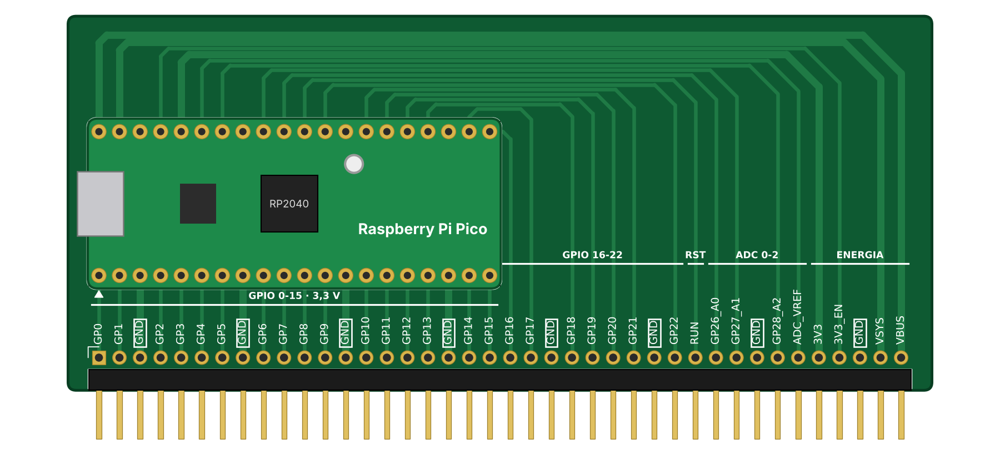
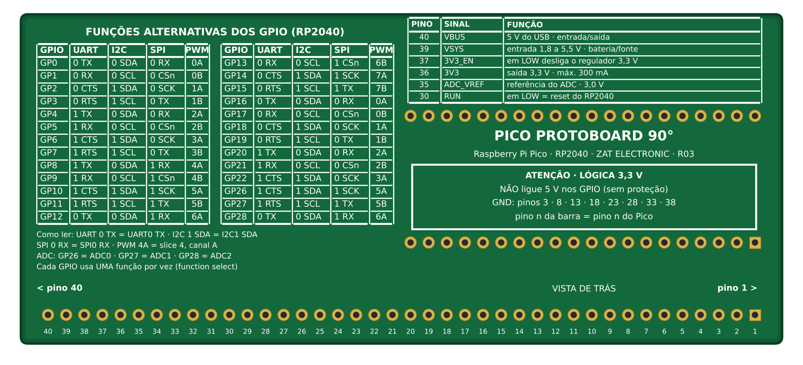

# PICO PROTOBOARD 90° — Raspberry Pi Pico em pé na protoboard

Placa adaptadora da **Zat Electronic**: o **Raspberry Pi Pico (RP2040)** encaixa em 2 barras fêmea 1×20 e **todos os 40 pinos** saem numa **barra de pinos 1×40 a 90°** na borda de baixo. A placa fica **em pé na protoboard** e ocupa só **uma linha de furos por pino** — sobra a protoboard inteira para o circuito.

  

## Funcionalidades
- ✅ **Pico padrão** (RP2040) removível, em 2 barras fêmea 1×20
- ✅ **Barra 1×40 90°** na borda: **pino n da barra = pino n do Pico** (1 → 40 da esquerda para a direita, vista de cima)
- ✅ Nome de cada pino na serigrafia (frente), **GND destacados em caixa** e **grupos de pinos** (GPIO · RST · ADC · ENERGIA)
- ✅ **Verso didático com tabelas de traços** (letra 1,0 mm): funções de cada GPIO (UART · I2C · SPI · PWM), tabela de alimentação/controle (VBUS, VSYS, 3V3, 3V3_EN, ADC_VREF, RUN), quadro de atenção 3,3 V e lista dos GND
- ✅ Cantos arredondados (r = 1 mm)
- ✅ Roteamento numa camada só, **sem via**, sem cruzamentos; GND sólido no verso
- ✅ VBUS, VSYS, 3V3 e GND com trilha de 0,6 mm; sinais 0,3 mm
- ✅ 100% THT · 2 camadas · **106,68 × 46,26 mm**

## Pinagem da barra J1 (vista de cima, da esquerda para a direita)

| J1 | Sinal | J1 | Sinal | J1 | Sinal | J1 | Sinal |
|---|---|---|---|---|---|---|---|
| 1 | GP0 | 11 | GP8 | 21 | GP16 | 31 | GP26_A0 |
| 2 | GP1 | 12 | GP9 | 22 | GP17 | 32 | GP27_A1 |
| 3 | GND | 13 | GND | 23 | GND | 33 | GND (AGND) |
| 4 | GP2 | 14 | GP10 | 24 | GP18 | 34 | GP28_A2 |
| 5 | GP3 | 15 | GP11 | 25 | GP19 | 35 | ADC_VREF |
| 6 | GP4 | 16 | GP12 | 26 | GP20 | 36 | 3V3 |
| 7 | GP5 | 17 | GP13 | 27 | GP21 | 37 | 3V3_EN |
| 8 | GND | 18 | GND | 28 | GND | 38 | GND |
| 9 | GP6 | 19 | GP14 | 29 | GP22 | 39 | VSYS |
| 10 | GP7 | 20 | GP15 | 30 | RUN | 40 | VBUS |

> Os 3 pinos de debug (SWCLK · GND · SWDIO) não passam pela placa: solde direto no Pico.

## Verso da placa (tabela de funções)

  

Como ler a tabela: na coluna UART, `0 TX` = UART0 TX; na coluna I2C, `1 SDA` = I2C1 SDA; na coluna PWM, `4A` = slice 4, canal A. ADC: GP26 = ADC0, GP27 = ADC1, GP28 = ADC2.

Cada GPIO usa **uma** função por vez (o RP2040 escolhe pelo *function select*). Ex.: GP4 pode ser `UART1 TX`, `I2C0 SDA`, `SPI0 RX` ou `PWM2 A`.

## Montagem
1. Solde as barras macho no Pico (se ainda não tiver).
2. Solde as **2 barras fêmea 1×20** nos furos do Pico (fileiras a 17,78 mm).
3. Solde a **barra 1×40 90°**: corpo plástico deitado sobre a placa, pinos saindo pela borda de baixo.
4. Encaixe o Pico (USB para a esquerda, pino 1 = GP0 no quadrado) e espete a placa em pé na protoboard.

## Cuidados
- Lógica **3,3 V** direto do RP2040, sem proteção: não ligue 5 V nos GPIO.
- **VBUS** = 5 V do USB. Alimentação externa entra por **VSYS** (não injete tensão em VBUS com o USB ligado).

## Lista de materiais
| Ref. | Qtd | Item | Footprint |
|---|---|---|---|
| U1 | 1 | Raspberry Pi Pico (RP2040) com barras macho | ZAT_Board_RaspberryPi:RASPBERRY_PI_PICO_H |
| — | 2 | Barra fêmea 1×20 passo 2,54 mm (encaixe do Pico) | nos furos do U1 |
| J1 | 1 | Barra de pinos macho 1×40 90° passo 2,54 mm | ZAT_Connector:PinHeader_1x40_P2.54mm_Horizontal_EdgeMount |

## Esquemático (KiCad 10)
| Pág. | Folha | Conteúdo |
|---|---|---|
| 1 | Capa (A2) | blocos, pinagem colorida da barra, vista da placa |
| 2 | PICO | U1 + global labels dos 40 pinos + **função de cada pino ao lado do label** + legenda de cores |
| 3 | BARRA_90 | J1 1×40 90° com a função de cada pino |

## Arquivos
- `PICO_PROTOBOARD_90.kicad_pro` — projeto KiCad 10 (bibliotecas globais KiCad + ZAT, sem pasta lib)
- `Zat_TitleBlock.kicad_wks` — moldura Zat Electronic

## Licença / autor
Projeto **Zat Electronic** — Kenneth Zat · Osasco/SP · hardware aberto.

*Revisão R03 — 2026-11-13 — KiCad 10.*
